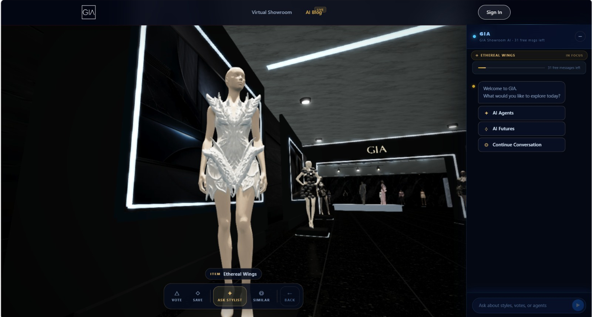
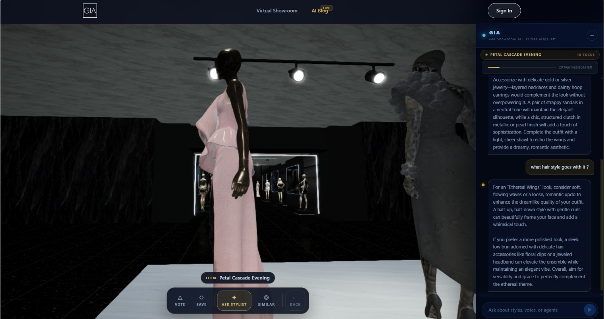
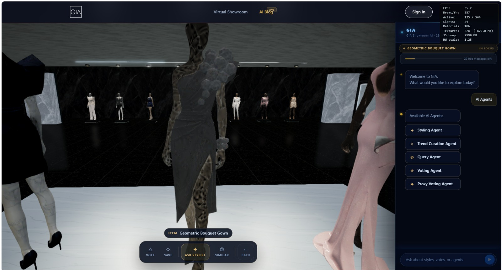
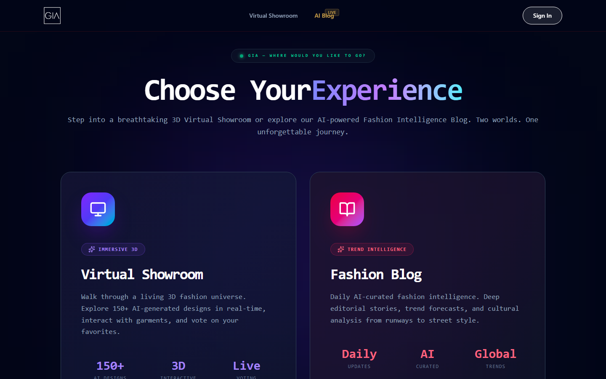
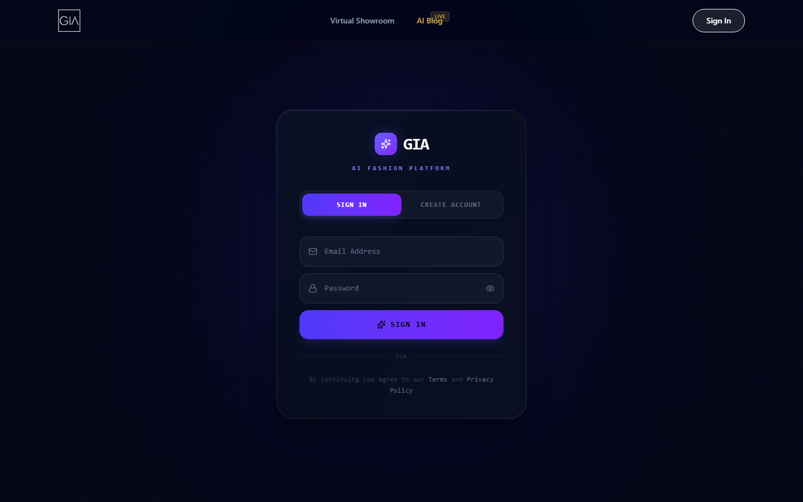
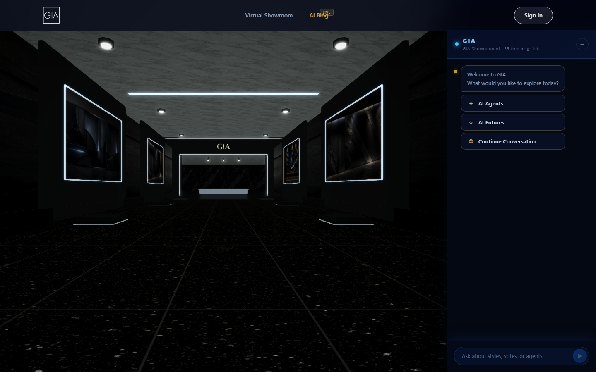

# GIA virtual fashion showroom

GIA is a luxury fashion platform you walk through in the browser: a first-person 3D showroom of
AI-generated gowns, shoes and bags on mannequins, where visitors inspect a piece, vote on it,
save it to a collection and ask an AI stylist about it, alongside an AI-curated fashion blog,
accounts, pricing plans and user and admin dashboards. It was built for a Fiverr client in
Bulgaria and deployed on DigitalOcean with Supabase for the database and model storage.

I took the project over from previous developers with a four-day, KPI-based brief: make the
showroom production-ready and fast on an ordinary 16 GB laptop with integrated graphics without
degrading its look. I diagnosed and fixed the rendering and device-detection bugs, optimised the
asset pipeline, made the FastAPI backend deployable, wired the React app shell to it, and shipped
the whole thing to production with a written delivery report.



## What it does

**For visitors**
- Walk the showroom in first person (mouse and keyboard on desktop, joystick and touch on
  mobile), click a mannequin to orbit it cinematically, and use Vote, Save, Ask Stylist,
  Similar and Back from the inspect bar
- Chat with the GIA stylist, which knows which piece is in focus; 30 free messages a day, then
  a premium prompt
- Read the fashion intelligence blog, like and comment on articles
- Sign up with an emailed one-time code, sign in, keep collections and voting history on a
  personal dashboard, and pick a plan on the pricing page (Stripe checkout, skippable in demo
  mode)

**For the owner**
- An admin dashboard, a design-generation job API and a scheduled pipeline that scrapes fashion
  sources, builds trend signals and generates new designs
- One backend behind one base URL: the browser never talks to Supabase directly

## Making it fast without making it ugly

The client's rule was "no aggressive compression", so the work went into the pipeline, not the
art:
- **Device classification fixed:** Intel integrated GPUs, including the Core Ultra "Intel(R)
  Graphics" string, now land on the constrained tier; this one bug had been bypassing every
  other optimisation on the client's own laptop
- **Texture and mesh pipeline:** PNGs mislabelled as WebP re-encoded (25 MB to 8.6 MB), 84
  mannequin and accessory textures capped at 1024 px (252 MB to 203 MB on disk, about 75% less
  GPU memory each), outlier meshes decimated (one gown from 2.4 M vertices to 195 k), welcome
  sign texture cut from 4096 to 1024 px
- **Render passes cut:** floor mirror resolution tiered and refreshed every few frames,
  pedestal mirrors off on weak GPUs, glow pass at 40-60% resolution, light count per material
  capped, clear-coat disabled on constrained tier, about 50 PBR materials frozen at steady state
- **Input and lifecycle:** mouse picking throttled to one per frame, mannequins culled by
  distance with hysteresis, engine disposed on page hide, camera near and far planes fixed for
  mobile depth precision
- **Measured, not guessed:** a `?perf=1` overlay shows FPS, draw calls, active meshes, lights,
  textures and heap; a `?lite=1` flag turns mirrors, glow and shadows off as a safety valve

Result on the client's machine: inspect-mode FPS from 14-18 to a stable 30, corridor walking
from 7-13 to 15-35, and the white-screen crash after long walks gone.

## Backend

A single FastAPI service (about 75 endpoints) on asyncpg over Supabase Postgres, with
APScheduler jobs for scraping, embeddings, proxy voting and the feedback loop. Auth is JWT with
bcrypt passwords and an OTP e-mail step over Gmail SMTP; the stylist chat uses OpenAI with daily
free and hourly paid quotas; Stripe is wired but off behind `FREE_DEMO_MODE`. Deployment to
DigitalOcean App Platform is described by `.do/app.yaml` and `DEPLOY.md`, with a nine-step
smoke test; the Playwright-based design agent is split into `requirements-design.txt` so the
web service stays small.

## Stack

| Layer | Choice |
|---|---|
| 3D | Babylon.js 8, Howler.js for procedural and zone-based audio |
| App shell | React 19, Vite 8, React Router 7, Tailwind CSS 4, GSAP, Lucide icons |
| Backend | Python, FastAPI, asyncpg, APScheduler, python-jose, passlib, Stripe, OpenAI |
| Data | Supabase Postgres (pooler) and Supabase Storage for GLB models |
| Asset tooling | gltf-transform, sharp, custom Node scripts for re-encoding and decimation |
| Hosting | DigitalOcean App Platform (frontend static site and backend service), Vercel config for the standalone showroom |

## Engineering

- Twenty-three documented patches, each naming the file, the change and its measured effect
- Backend readiness fixes: `requirements.txt` re-encoded from UTF-16, optional dependencies
  split out, `.env.example` with every required variable, runbook and smoke test
- A delivery report in the repository root records the acceptance criteria, the nine smoke
  tests and the before-and-after performance numbers

## Screenshots

| | |
|---|---|
|  |  |
| Ask the stylist about the piece in focus | The `?perf=1` overlay during a walk |
|  |  |
| Landing page: showroom or blog | Sign in and OTP sign-up |
|  | |
| The showroom hall rendered locally without the model catalogue | |

The first three images are captures of the production deployment on DigitalOcean from delivery
day. The other three are the built React app served locally without a backend: the hall, floor
and lighting render from the repository, but the mannequins are missing because the GLB models
are fetched from the API and were left out of this repository (see below).

## Running it locally

```
cd Gia-Backend-V5-Deploy
python -m venv .venv && .venv\Scripts\activate
pip install -r requirements.txt
cp .env.example .env                      # POSTGRESQL_URI, OPENAI_API_KEY, JWT_SECRET, GMAIL_*, ALLOWED_ORIGINS
uvicorn main:app --port 8000 --reload     # GET /health -> {"status":"ok","db":"connected"}

cd ../Gia-Virtual-Studio-Frontend-V1
npm install
cp .env.example .env                      # VITE_BACKEND_API_URL=http://127.0.0.1:8000
npm run dev                               # app shell; /studio needs the GLB catalogue from the backend

cd ../GIA/GIA/GIA
npm install && npm run dev                # standalone showroom on http://localhost:8081 (needs ASSETS/Models)
```

Real `.env` files and keys were deliberately excluded; copy the `.env.example` files and fill
them in.

## Repository notes

- Three codebases live side by side: `GIA/GIA/GIA/` (the standalone Babylon.js showroom where
  the performance work was done), `Gia-Virtual-Studio-Frontend-V1/` (the React app that embeds
  the showroom at `/studio`, the version that was deployed) and `Gia-Backend-V5-Deploy/` (the
  API). `Gia-Virtual-Studio-Frontend/` is the older frontend kept for reference.
- All `*.glb` 3D models (about 2.4 GB) were excluded from the repository, as was the showroom's
  2.3 GB nested git history (`GIA/GIA/GIA/.git-history-TOOLARGE/`). The `.git-history/`
  folders that remain are nested git metadata preserved as plain files.
- `GIA/PROJECT_STATE.md` and `GIA/HOLD.md` are the working notes from the engagement;
  `Screenshots_New folder (3)/` holds the original delivery-day captures.
